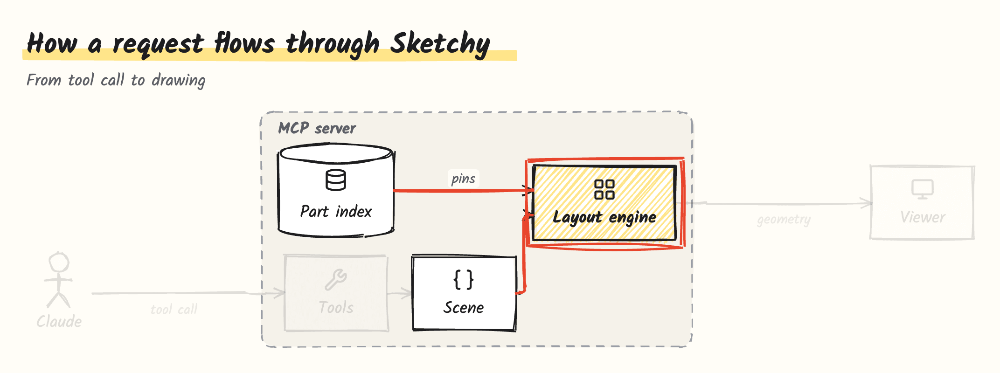
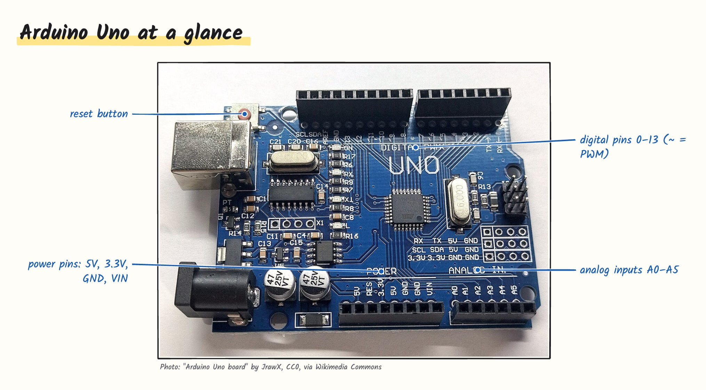
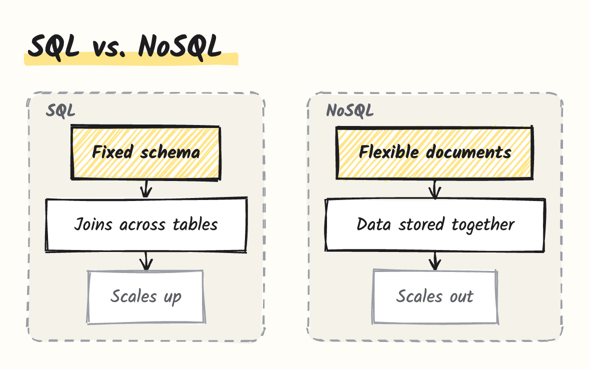

# Sketchy

> Totally sketchy explanations.

Sketchy is an [MCP](https://modelcontextprotocol.io) server that lets Claude **draw while it explains**: clean, hand-drawn, interactive diagrams rendered right inside the chat.

Claude decides **what** to draw and label. Sketchy decides **where**: a part library with named anchor points and automatic layout. Claude never computes coordinates, so drawings come out precise and consistent every time.



## What it does

### Architecture diagrams from your code

Ask _"Explain my repo"_. Claude reads the code and draws modules, folders and data flow. **Click a box to open the file** in VS Code, Cursor, Windsurf or Zed; hover to see what it does.


### Step-by-step walkthroughs

Every drawing can carry steps. Click through them: the parts that matter are circled in red pen, everything else fades back. Arrow keys work too.

### Wiring diagrams for Arduino sketches

Ask _"How is my sketch wired?"_. Claude reads `pinMode`, `digitalWrite` and friends, places real parts (50 boards, sensors, displays and modules from [wokwi-elements](https://github.com/wokwi/wokwi-elements)) and connects pins. Sketchy routes the wires and places the callouts.


### Labeled photos

Claude finds a freely licensed photo (Wikimedia Commons, Openverse), and a vision model **running on your computer** ([Florence-2](https://huggingface.co/microsoft/Florence-2-base-ft)) locates the parts and printed text to label. Attribution is always shown.



### Comparisons, flows and metaphors

Sketchy ships explanation patterns (structure, flow, comparison, metaphor) so Claude picks the right kind of drawing for any topic, not just hardware.



### Export

Download any drawing as **SVG** or **PNG**, fonts included.

## Install

### Claude Desktop

1. Download the `.mcpb` file for your platform from the [latest release](https://github.com/ddkbs/sketchy/releases/latest).
2. Double-click it (or drag it into **Settings → Extensions**) and confirm.
3. Optional: in the extension settings choose your editor and where Sketchy stores its data.

The photo-labeling model is **not** part of the download. The first time Claude labels a photo, Sketchy asks you to pick a model size:

| Model  | Download | Memory  | Notes                                     |
| ------ | -------- | ------- | ----------------------------------------- |
| Small  | ~280 MB  | ~1 GB   | Recommended. Printed text, distinct parts |
| Medium | ~830 MB  | ~2.5 GB | Better grounding of small parts           |
| Large  | ~3.1 GB  | ~4.5 GB | Most precise                              |

### Other MCP clients

Sketchy is a standard MCP server and works in any client that supports [MCP Apps](https://github.com/modelcontextprotocol/ext-apps):

```json
{
  "mcpServers": {
    "sketchy": {
      "command": "node",
      "args": ["/path/to/sketchy/dist/index.js"],
      "env": { "SKETCHY_EDITOR": "cursor" }
    }
  }
}
```

### Remote

The drawing core has no local dependencies and can be hosted for Claude on the web and on mobile:

```bash
node dist/index.js --http --port 3000
```

The endpoint is `http://<host>:3000/mcp` (Streamable HTTP, one scene per session). Photo labeling stays off in this mode unless `SKETCHY_PHOTOS=on`.

## Try it

- _"Explain the Arduino Uno with Sketchy."_
- _"Explain the architecture of /path/to/my/repo, then walk me through one request."_
- _"How is this sketch wired?"_ followed by your `.ino` file
- _"Compare TCP and UDP."_
- _"Explain a CPU cache with an everyday metaphor."_

The same patterns are available as prompts: `explain-structure`, `explain-flow`, `compare`, `metaphor`, `explain-repo` and `explain-circuit`.

## How it works

```
Claude calls tools (sketch, add_node, place_part, connect, label, add_step, …)
          ↓
Scene: nodes, groups, parts, wires, labels, photos, steps — no coordinates
          ↓
Layout engine (elkjs): positions, orthogonal routing, collision-free callouts
          ↓
Viewer (MCP App): hand-drawn rendering with rough.js, hover, steps, export
```

Every feature fills the same scene, and a single viewer renders it. The visual style lives in the renderer, so every drawing looks consistent no matter what Claude asks for.

<details>
<summary>Tools</summary>

| Tool                                                | Purpose                                         |
| --------------------------------------------------- | ----------------------------------------------- |
| `sketch`                                            | Draw a whole scene in one call                  |
| `new_scene`, `render`                               | Build a scene incrementally, then show it       |
| `add_box`, `add_node`, `add_text`, `add_group`      | Boxes, code nodes (clickable), notes and groups |
| `add_arrow`, `add_edge`                             | Arrows between elements                         |
| `place_part`, `connect`, `search_parts`             | Electronic parts and wires                      |
| `label`                                             | Callouts on pins, photo regions or nodes        |
| `add_step`                                          | Walkthrough steps                               |
| `search_icons`                                      | Lucide icons and technology logos               |
| `find_image`, `locate`, `add_image`, `choose_model` | Photo search, local grounding, model setup      |

</details>

## Configuration

| Variable           | Default      | Description                                                                     |
| ------------------ | ------------ | ------------------------------------------------------------------------------- |
| `SKETCHY_EDITOR`   | `vscode`     | Editor for file links: `vscode`, `cursor`, `windsurf`, `vscode-insiders`, `zed` |
| `SKETCHY_PHOTOS`   | `on`         | `off` disables photo search and labeling                                        |
| `SKETCHY_DATA_DIR` | `~/.sketchy` | Models, cached photos and the local SQLite database                             |

## Development

Requires Node.js 20 or later.

```bash
npm install
npm run build      # part catalog, server and viewer
npm test
npm run preview    # viewer with sample scenes at http://localhost:5173/preview.html
npm run pack       # .mcpb bundle for the current platform
```

See [CONTRIBUTING.md](CONTRIBUTING.md) for the project layout.

## License

[MIT](LICENSE) © ddkbs. Sketchy builds on open-source work listed in [THIRD_PARTY_NOTICES.md](THIRD_PARTY_NOTICES.md).
